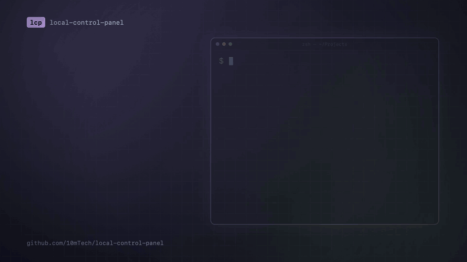

# local-control-panel

[](LICENSE)

A keyboard-driven terminal panel for every project in one folder. One screen shows each project's
stack, git state, what is running, disk use and how recently it was touched. One keystroke opens it
in herdr, starts or stops its dev server, pulls it, cleans its build folders or archives it. Every
action goes into an append-only, hash-chained audit log that you can read inside the panel.

```bash
lcp          # run from any terminal; actions need herdr
```

> **Status: early (0.x).** macOS only. Expect rough edges and breaking changes before 1.0.



## Features

- **One screen for all projects:** stack, git state (dirty, ahead, behind, no git), listening ports,
  Docker containers, disk and build-folder size, and age.
- **One-key actions:** open in herdr, editor, Claude Code, run and stop dev servers, fetch all,
  pull, init, clean to the Trash, archive and restore.
- **Safe by design:** previews and confirmations, Trash instead of delete, fast-forward-only git,
  and stop only by recorded PID. The rules are fixed in code.
- **Audited:** every action is logged before and after in an append-only JSONL file with a sha256
  hash chain, with secrets masked.

## Install

Needs Go 1.24 or newer, on macOS.

```bash
go install github.com/10mTech/local-control-panel/cmd/lcp@latest
```

Prebuilt binaries are coming in a later release.

## Uninstall

1. Stop any dev servers the panel started (`s` on the Runs screen, `L`), then quit with `q`.
2. Remove the binary:

   ```bash
   trash "$(go env GOPATH)/bin/lcp"
   ```

3. Optional: remove the config and the state folder (audit log, run logs, caches). Keep the state
   folder if you want the audit history.

   ```bash
   trash ~/.config/local-control-panel ~/.local/state/local-control-panel
   ```

   If you set `XDG_CONFIG_HOME`, `XDG_STATE_HOME` or `state_dir`, remove those folders instead.

lcp keeps nothing inside your projects. Anything it cleaned or trashed stays in the Trash, and
archived projects stay in `archive/`. Uninstalling doesn't touch them.

## Documentation

Full documentation (screens, keys, safety rules, audit log, configuration) is on the
[project website](https://10mtech.github.io/local-control-panel/). Its source is [docs/index.html](docs/index.html).

## Contributing

Contributions are welcome. Read [CONTRIBUTING.md](CONTRIBUTING.md) first. If you use AI tools, also
read [AGENTS.md](AGENTS.md).

Please follow the [Code of Conduct](CODE_OF_CONDUCT.md). Report security issues privately as
described in [SECURITY.md](SECURITY.md).

## License

[MIT](LICENSE) © 10mTech
